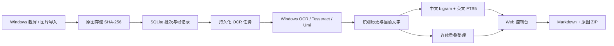

# V2 后端结构

`src/Screen.App` 是一个 ASP.NET Core 进程，原生页面无 npm 构建依赖。`WindowsDesktop=true` 构建额外启用 WinForms 热键消息循环、区域选择、GDI 截图和 WinRT OCR。通用构建不引用 Windows 桌面程序集，可以在 Linux 上运行完整的图片导入流程。

## 记录与任务

- `runs`：批次及结束状态。
- `frames`：顺序、原图哈希、采集区域、来源、当前识别结果。
- `jobs`：独立识别任务，状态为 pending / processing / succeeded / failed。
- `ocr_results`：不可覆盖的识别与人工校对历史。
- `search`：FTS5 派生索引。
- `run_notes`：画面不稳定、衔接不确定等采集说明。
- `settings`：当前采集区域。

原图先写入临时文件，再原子移动到内容地址；提交数据库记录和任务后，后台工作者才可见。序号分配和帧记录在同一 SQLite 事务内。多个观察可以引用同一原图，观察记录仍各自存在。

OCR 不在 HTTP 请求内执行。进程停止时留下的 processing 任务在下次启动恢复为 pending；失败任务保留错误，由用户重试。重新识别产生新任务与历史，不修改原图。校对更新当前文字与检索索引，保留过去的识别结果。

## 本地控制台

控制台只接受回环连接和本机 Host。写操作检查浏览器提供的 Origin 和 Sec-Fetch-Site，本机命令行调用可省略这些标头。页面及 API 响应带 CSP 和 nosniff。静态资源由 ASP.NET Core 的 wwwroot 提供，证据图通过帧 ID 查出 SHA-256，再从数据目录读取。

## 整理与画面衔接

正文只删除上一帧后缀与下一帧前缀连续一致、至少三行且不少于四十字符的重叠；不依赖全局单句锚点。原图相同且文字相同的相邻帧可直接折叠正文，帧记录仍保留。不确定时保留新帧文字并提示核对。该规则是保守启发式，原始证据始终是核对依据。

滚动先记录首帧，再逐步移动。画面位移在缩略灰度图上估计，比较方向为 `new[y] ~ old[y + dy]`，根据缩略图与原图高度换算物理位移。匹配误差、相对改善和候选唯一性共同决定是否可信；遇到不确定的衔接停止自动滚动。该机制不声称能够绝对保证任意动态应用的内容完整。

页面单帧截图在倒计时结束时绑定前台窗口，取图前后校验前台窗口、窗口位置和鼠标。滚动复用取图校验，并每约 200ms 检查画面是否稳定，默认等待窗口为 2000ms。

## 检索

中文按相邻双字切词，英文按词切分，查询的各 token 做 AND 匹配，结果按 FTS5 BM25 排序。单字查询直接查当前原文。结果定位到帧，重复帧可能有多个结果；未实现语义问答或向量检索。

## 验证

`dotnet test Screen.sln` 覆盖真实 SQLite 存储、并发序号、失败恢复、修订和索引、误锚点回归、画面位移，以及 API 导入—识别—检索—校对—导出流程。测试中的 OCR 和桌面驱动有明确替身；实际 OCR 用 `tools/smoke.py` 另行验证。`tools/browser-smoke.cjs` 检查真实浏览器操作和移动端布局，需要安装 Playwright 与 Chromium。

Windows 目标可从 Linux 交叉构建与发布；交叉构建通过不等于热键、WinRT、屏幕或 DPI 行为已经在 Windows 实机验收。
